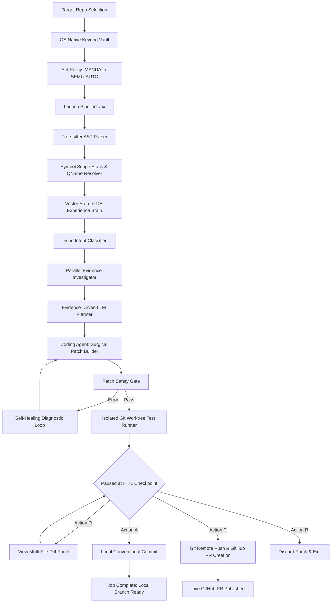

# Forge ⚡

Production-Grade Agentic AI Software Engineer powered by Evidence-Driven Planning, OS Keyring Vault, & Deterministic AST Verification.

## 📌 End-to-End System Architecture

```text
  ┌─────────────────────────────────────────────────────────┐
  │ 1. INITIALIZATION & SECURITY VAULT                      │
  │    Target Repo -> OS Keyring Vault -> Policy Setup      │
  └────────────────────────────┬────────────────────────────┘
                               │ /fix
                               ▼
  ┌─────────────────────────────────────────────────────────┐
  │ 2. CODE INDEXING & SEMANTIC GRAPH                       │
  │    Tree-sitter AST -> Scope Stack -> DB Experience Brain│
  └────────────────────────────┬────────────────────────────┘
                               │
                               ▼
  ┌─────────────────────────────────────────────────────────┐
  │ 3. MULTI-AGENT REASONING & PLANNING                     │
  │    Intent Classifier -> Evidence Investigator -> Planner│
  └────────────────────────────┬────────────────────────────┘
                               │
                               ▼
  ┌─────────────────────────────────────────────────────────┐
  │ 4. VERIFICATION & SELF-HEALING LOOP                     │
  │    Patch Safety Gate -> Worktree Test Runner            │
  └────────────────────────────┬────────────────────────────┘
                               │
                               ▼
  ┌─────────────────────────────────────────────────────────┐
  │ 5. HUMAN-IN-THE-LOOP INTERACTIVE GATE                   │
  │    [D] View Diff | [A] Approve | [P] Publish | [R] Reject│
  └──────────────┬──────────────────────────┬───────────────┘
                 │                          │
           [A] Approve                [P] Publish
                 │                          │
                 ▼                          ▼
    ┌────────────────────────┐  ┌────────────────────────┐
    │ Local Commit Ready     │  │ Live GitHub PR Published│
    └────────────────────────┘  └────────────────────────┘
```



## 🚀 Key Features

- **Issue Understanding**: Parses issues into intent, code symbols, target files, and test suites.
- **Repository Brain**: Zero-token experience recall of past resolved issues via PostgreSQL & vector search.
- **Adaptive Evidence Investigator**: Fast parallel evidence gathering (~15ms) with contradiction checking.
- **Evidence-Driven Planner**: Minimal AST context slicing ($\le 2,500$ tokens) & zero-hallucination DB tree verification.
- **Git Worktree Isolation**: Symbol-aware code patching in isolated git worktrees with AST pre-flight safety gates.
- **Interactive Gate Controls**: Terminal button/shortcut UI (`[A]`, `[D]`, `[P]`, `[R]`) for Human-in-the-Loop patch inspection and approval.
- **OS Native Vault**: Secure API key storage using OS Credential Manager (Keyring).

## 🛠️ Stack

- **Language**: Python 3.11 (`uv` / `pip` virtual environment)
- **UI & REPL**: Rich Terminal UI with Interactive Keyboard Controls
- **Parsing**: Tree-sitter AST & Call Graph Resolver
- **Database & Cache**: PostgreSQL, Redis, Qdrant
- **Security**: OS Keyring Credential Manager
- **LLMs**: DeepSeek, OpenAI, Anthropic, Ollama

## 📥 Step-by-Step Setup & Running Guide

### 1. Clone the Repository

```powershell
git clone https://github.com/Aneesh1703/Forge.git
cd Forge
```

### 2. Start Infrastructure Services (Docker Compose)

Spin up PostgreSQL 17, Redis 7, Qdrant Vector Store, and Ollama in background containers:

```powershell
docker compose up -d
```

### 3. Environment Setup & Dependencies

```powershell
cd backend
python -m venv .venv
.\.venv\Scripts\Activate.ps1
pip install -e .
```

### 4. Configure API Credentials (OS Vault)

Launch the Forge REPL and set your secret credentials securely:

```powershell
python -m app.cli.repl
```

Inside the Forge shell:

```text
forge ❯ /config set-key -p github -k ghp_YourGitHubPersonalAccessToken
forge ❯ /config set-key -p deepseek -k sk-YourDeepSeekApiKey
```

### 5. Execute Repair & Publish PR

Set execution policy and start automated repair:

```text
# Set policy to Semi-Autonomous (Human-in-the-Loop)
forge ❯ /policy semi

# Initiate repair pipeline
forge ❯ /fix
```

At the interactive gate prompt:
- Press **`d`** to inspect the generated code diff.
- Press **`p`** to automatically branch, stage, commit, push, and open a **GitHub Pull Request**!

## 📜 License

Distributed under the **Apache License 2.0** with Additional Commercial, Attribution & SaaS Restrictions. See [`LICENSE`](LICENSE) for details.
